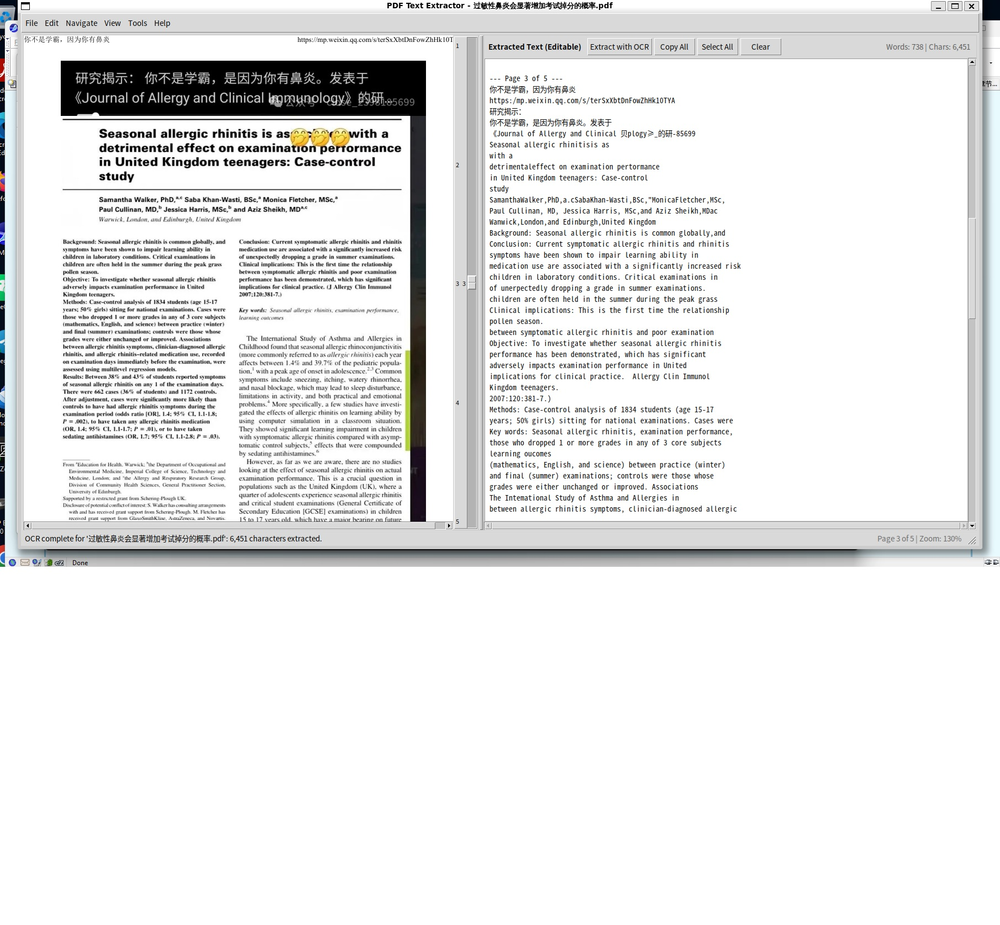

# PDF Text Extractor

A modular Python desktop tool and command-line utility for reading PDF files, previewing pages, and extracting editable text from entire PDF documents — including image-based text via integrated OCR.



## Features

- **Split GUI Interface**:
  - **Left Panel (PDF Displaying Panel)**:
    - **Full-Height Display**: Clean, streamlined layout without top toolbar clutter; the canvas extends all the way to the top.
    - **Vertical Page Sliding Bar**: A prominent, dedicated vertical sliding bar along the right edge of the PDF displaying panel. Sliding it up and down moves through document pages with numbered tick marks.
    - **Drag-to-Pan (Hand Tool)**: Click and drag anywhere on the PDF image to pan in any direction.
    - **Smart Mouse Wheel Scrolling**: Scrolling the mouse wheel down at the bottom of a page automatically advances to the next page.
    - **Ctrl + Mouse Wheel Zoom**: Hold `Ctrl` and scroll the mouse wheel to zoom in and out smoothly.
  - **Right Panel (Text Editor)**:
    - Editable document text with live word and character counters.
    - Quick actions: "Extract with OCR", "Copy All", "Select All", and "Clear".
- **Draggable Splitter & Resizable Window**:
  - Interactive raised splitter divider: hover over the boundary line (`↔`) and drag to adjust panel proportions.
  - Fully resizable application window with corner resize grip (`ttk.Sizegrip`).
- **Built-in OCR (Optical Character Recognition)**:
  - Automatically detects when a PDF consists of scanned or embedded images (e.g. article screenshots or scanned documents).
  - Uses `rapidocr-onnxruntime` to accurately extract Chinese and English text directly from images inside the PDF.
  - Background threading prevents the GUI from freezing during OCR processing.
- **Menu Bar & Shortcuts**:
  - **File**: Open PDF (`Ctrl+O`), Save Extracted Text (`Ctrl+S`), Close Document (`Ctrl+W`), Exit (`Ctrl+Q`).
  - **Edit**: Undo (`Ctrl+Z`), Redo (`Ctrl+Y`), Cut, Copy, Paste, Select All (`Ctrl+A`).
  - **Navigate**: Next Page (`PgDn` / `Alt+Right`), Previous Page (`PgUp` / `Alt+Left`), First Page (`Home`), Last Page (`End`), Go to Page (`Ctrl+G`).
  - **View**: Zoom In (`Ctrl++`), Zoom Out (`Ctrl+-`), Fit Width (`Ctrl+F`), Reset (`Ctrl+0`).
  - **Tools**: Extract with OCR (`Ctrl+Shift+O`).
- **CLI Utility**:
  - Full-featured command line tool (`main_cmd.py`) to extract text to stdout or files, select specific page ranges, inspect metadata, and run OCR (`--ocr`).

## Project Structure

```text
PdfTextExtracter/
├── requirements.txt         # Dependencies (pymupdf, pillow, rapidocr-onnxruntime)
├── README.md                # Documentation and usage guide
├── main_gui.py              # GUI application entry point
├── main_cmd.py              # Command-line interface entry point
├── core/                    # Core PDF processing package
│   ├── __init__.py
│   ├── pdf_reader.py        # PDF document lifecycle, navigation, and page rendering
│   └── text_extractor.py    # Text extraction algorithms (vector text & OCR), page parsing, exporting
└── gui/                     # Graphical user interface package
    ├── __init__.py
    ├── app.py               # Main window controller, menus, shortcuts, threading, and status bar
    ├── pdf_panel.py         # Full-height PDF viewer with vertical page slider and canvas
    └── text_panel.py        # Editable text display widget with live statistics and OCR button
```

## Setup & Requirements

Activate the sandbox virtual environment:
```bash
source ~/vEnv/sandboxEnv/bin/activate
```

Install requirements:
```bash
pip install -r requirements.txt
```

*(Note: `python3-tk` must also be installed on the Linux system via `sudo apt install python3-tk`).*

## Usage

### 1. Launching the GUI

Launch the GUI application:
```bash
python main_gui.py
```

Or open a specific PDF file directly at launch:
```bash
python main_gui.py sample.pdf
```

### 2. Navigation & Zoom Controls

- **Move Pages**: Drag the vertical sliding bar on the right edge of the PDF displaying panel, use the mouse wheel, or use the **Navigate** menu (`PgDn`, `PgUp`, `Ctrl+G`).
- **Zoom**: Use the **View** menu (`Ctrl++`, `Ctrl+-`, `Ctrl+F` for Fit Width, `Ctrl+0` for 100%), or hold `Ctrl` while scrolling the mouse wheel.
- **Pan**: Click and drag on the PDF image to pan in any direction.

### 3. Using the Command Line Interface (CLI)

Print standard vector text:
```bash
python main_cmd.py sample.pdf
```

Extract text from images using **OCR** and save to a file:
```bash
python main_cmd.py sample.pdf --ocr -o ocr_result.txt
```

Extract specific pages (e.g. pages 1 to 3) with OCR without headers:
```bash
python main_cmd.py sample.pdf -p 1-3 --ocr --no-headers -o output.txt
```

Inspect document metadata and OCR recommendation:
```bash
python main_cmd.py sample.pdf --info
```

**Dong Sun Wong**
**Email**: [Reach out for collaborations](mailto:donwong07@gmail.com)
